<div align="center">

<picture>
  <source media="(prefers-color-scheme: dark)" srcset="apps/desktop/public/brand/playcounter-logo-on-dark.svg" />
  <source media="(prefers-color-scheme: light)" srcset="apps/desktop/public/brand/playcounter-logo-on-light.svg" />
  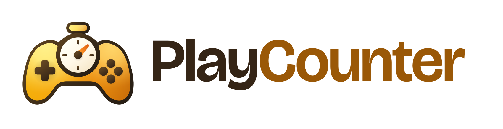
</picture>

### Every session counts.

**PlayCounter** is the free, open-source playtime tracker for Windows.<br />
It follows your games by itself, whatever you start them from, and keeps them all in one library.

[](https://github.com/zntr1/PlayCounter/releases/latest)
[](./LICENSE)
[](https://discord.gg/t2nG3jaEEY)
[](https://hosted.weblate.org/projects/playcounter/)

**[Download for Windows](https://github.com/zntr1/PlayCounter/releases/latest)** &nbsp;·&nbsp;
[Website](https://playcounter.app) &nbsp;·&nbsp;
[Guides](https://playcounter.app/guides/) &nbsp;·&nbsp;
[Trailer](https://playcounter.app/#trailer) &nbsp;·&nbsp;
[Discord](https://discord.gg/t2nG3jaEEY)

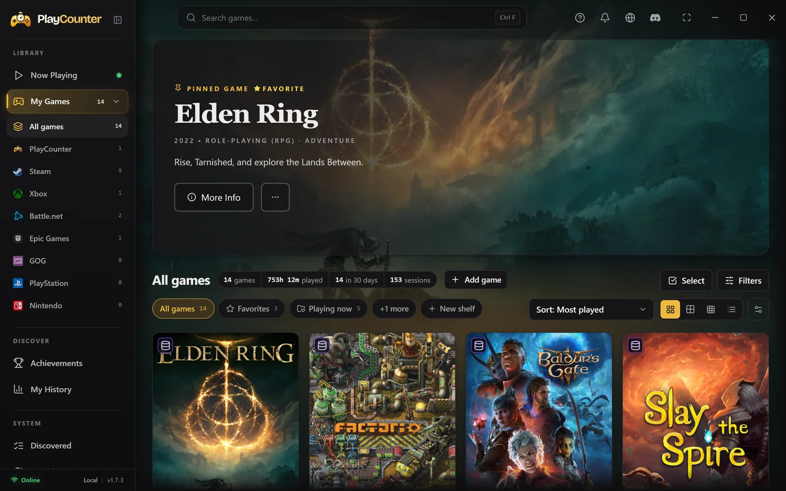

</div>

PlayCounter watches what's actually running on your PC and records playtime for
recognized games, regardless of how they were launched: Steam, Epic, GOG, EA,
Ubisoft, Battle.net, an emulator, a PC port like Ship of Harkinian, a shortcut
or a plain `.exe`. Unknown games can be added locally or submitted as community
matches for review. Sessions and history stay on your PC, and the free,
open-source app does not require an account.

Different AI models supported me in developing this application.

**On this page:** [What PlayCounter does](#what-playcounter-does) ·
[Download](#download) · [Privacy](#privacy) ·
[Open source](#why-the-desktop-client-is-open-source) ·
[Help translate](#help-translate) · [Development](#development)

## What PlayCounter does

### Start a game. That's it.

Open a game the way you always do. PlayCounter recognizes it, shows a live
session timer and saves the session when you quit. There is nothing to set up
per launcher, and you never have to start a game through PlayCounter. It can sit
in the tray the whole time.

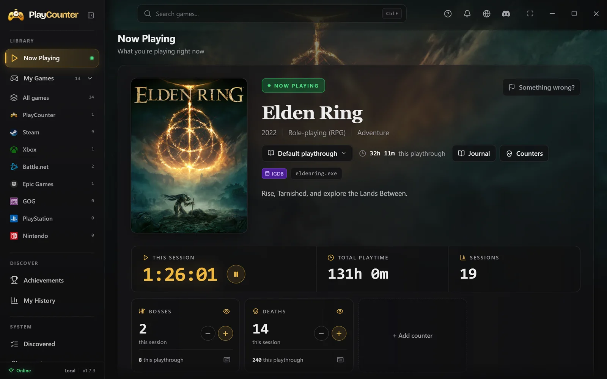

### One library for every game

My Games brings every game together with its cover, total hours and sessions,
whatever it came from. Sort and filter it, put games on shelves, give them a
status (In progress, On hold, Finished, Want to play, Want to replay, Not
planned) and a tier from S to F, and pick your own covers and banners.

<table>
  <tr>
    <td width="50%" valign="top">
      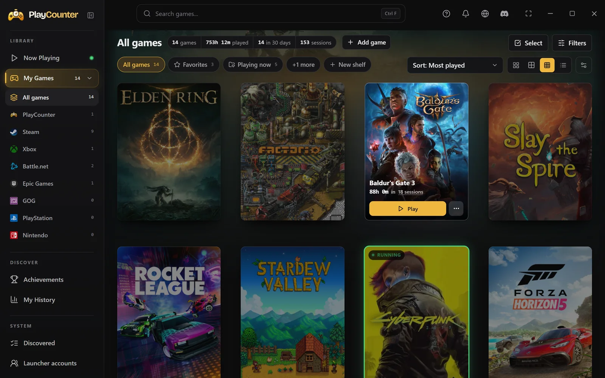
      <br />
      <b>Covers view.</b> Just your covers, big and calm. Standard cards, large
      cards and a list are one click away.
    </td>
    <td width="50%" valign="top">
      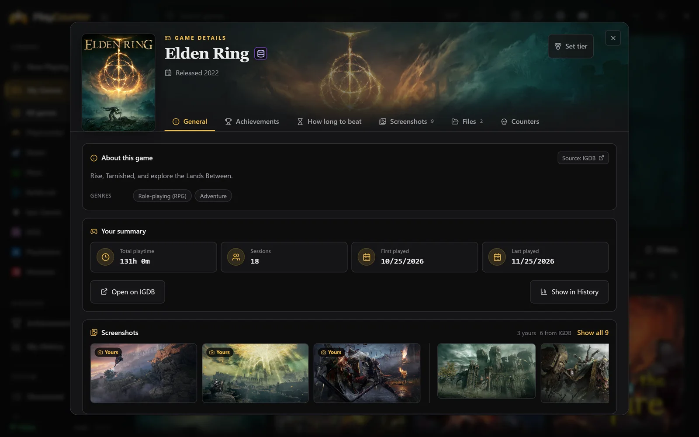
      <br />
      <b>Game details.</b> Playtime, sessions, achievements, how long to beat,
      screenshots, files and counters of one game in one place.
    </td>
  </tr>
</table>

### Your earlier hours come along

Tracking works without any import. The imports are worth it anyway: they bring
in the playtime your launchers and consoles already recorded, so a game doesn't
start at zero. You review every game before it comes in.

| From        | What comes in                                                                 | How                                           |
| ----------- | ----------------------------------------------------------------------------- | --------------------------------------------- |
| Steam       | Games, playtime, achievements                                                 | Reads the Steam accounts on this PC           |
| Xbox        | Games, the playtime games report to Xbox, achievements                        | Microsoft sign-in                             |
| Epic Games  | Games, playtime, achievements                                                 | Epic sign-in, or installed games without one  |
| GOG         | Games, playtime, achievements                                                 | GOG sign-in, or installed games without one   |
| PlayStation | PS5 and PS4 games, playtime, trophies, and what you play right now            | PlayStation sign-in                           |
| Nintendo    | Switch games and playtime, read again about once an hour                      | Nintendo Account sign-in                      |
| Battle.net  | Your game list (Battle.net shares no playtime; its games are tracked anyway) | Installed games, or Battle.net sign-in        |

Each launcher counts once and several accounts of one launcher add up.
PlayCounter compares the launcher totals with the time it tracked itself and
shows the higher number; console hours from PlayStation and Nintendo are added
on top. Hours from any other launcher can be set by hand.

<table>
  <tr>
    <td width="50%" valign="top">
      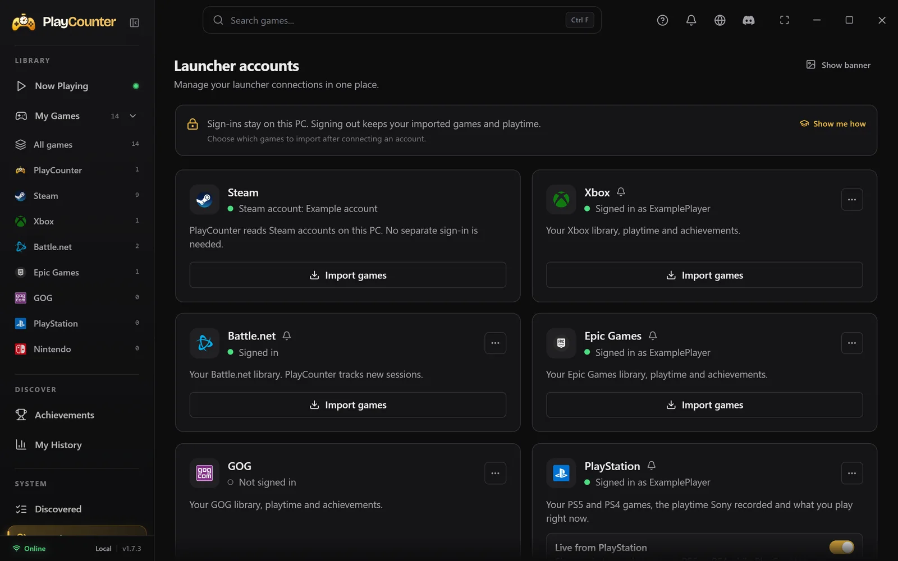
      <br />
      <b>Launcher accounts.</b> Sign in once. The sign-ins stay on your PC,
      encrypted by Windows.
    </td>
    <td width="50%" valign="top">
      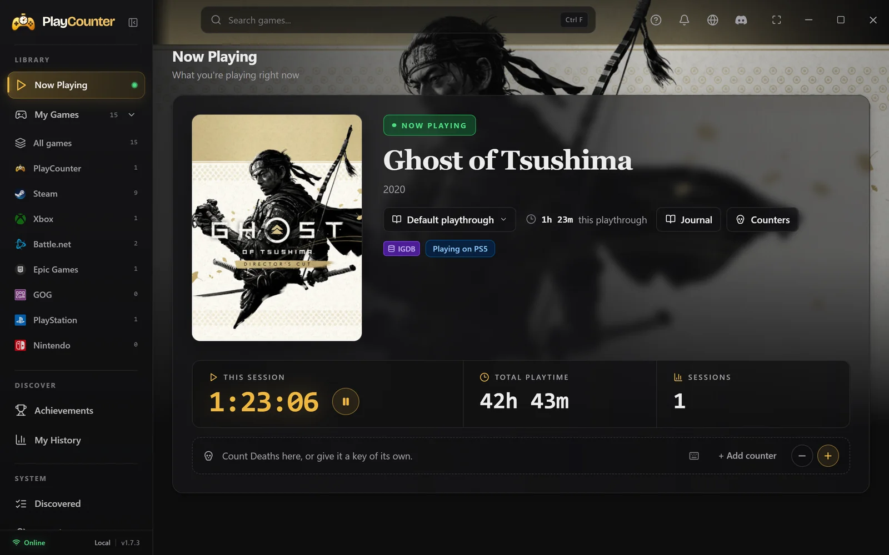
      <br />
      <b>Live from PlayStation.</b> A game you start on your PS5 or PS4 shows up
      in Now Playing within about a minute.
    </td>
  </tr>
</table>

### While you play

<table>
  <tr>
    <td width="50%" valign="top">
      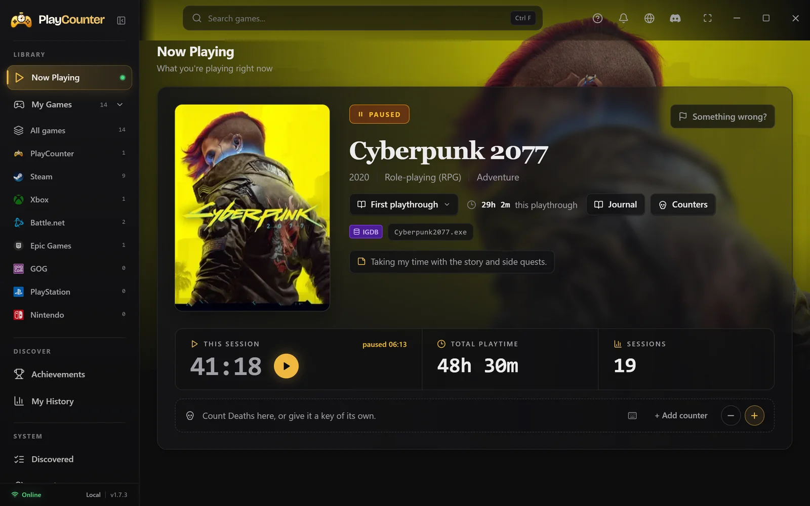
      <br />
      <b>Timer and pause.</b> A small timer can sit in a corner of your game.
      Pause a session without closing the game, or let it pause by itself when
      you step away. A reminder can tell you to take a break.
    </td>
    <td width="50%" valign="top">
      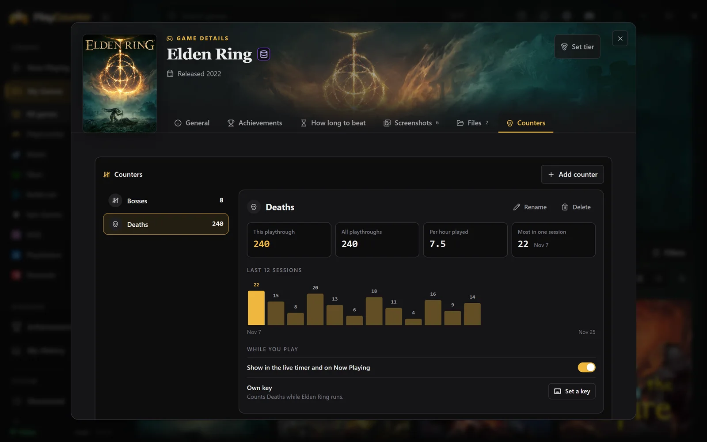
      <br />
      <b>Counters.</b> Count deaths, bosses or anything else with a key, a
      controller combo or the + button, and see the numbers per session.
    </td>
  </tr>
  <tr>
    <td width="50%" valign="top">
      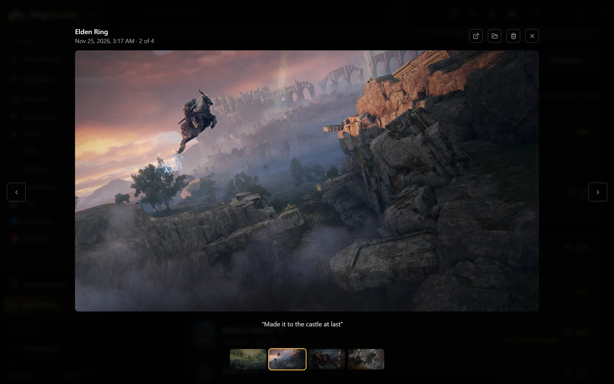
      <br />
      <b>Screenshots.</b> One key saves a picture of your game, no Steam or Game
      Bar needed. Add a caption right away. With HDR on, bright highlights are
      kept instead of cut off.
    </td>
    <td width="50%" valign="top">
      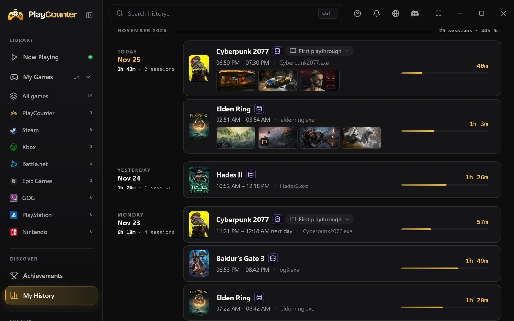
      <br />
      <b>Pictures on their session.</b> Every screenshot shows up on the session
      it was taken in. A session can carry a note, too.
    </td>
  </tr>
</table>

### Look back

My History shows where your hours went: one big number for any dates you pick,
compared with the time before, your longest session, best streak and most played
game, and every session with its date and length. Sessions can be edited, split
and combined.

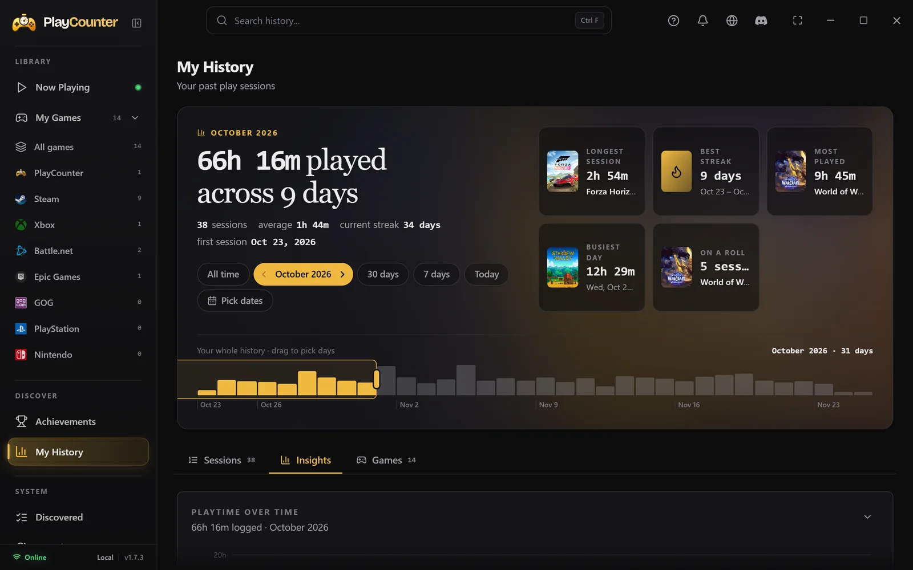

<table>
  <tr>
    <td width="50%" valign="top">
      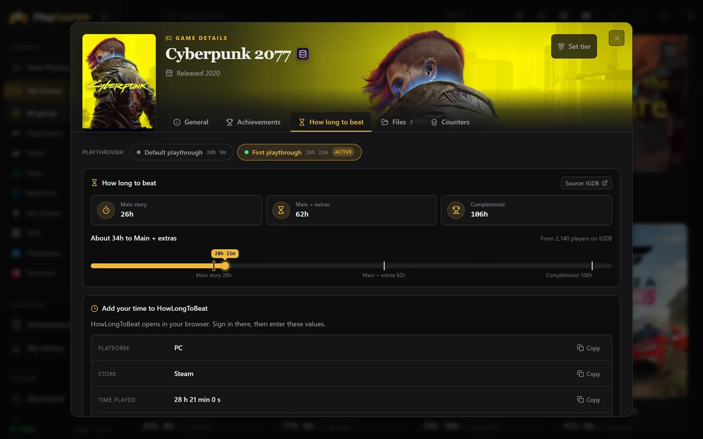
      <br />
      <b>How long to beat.</b> How long a game takes, how far you are and how
      much is left. Sort your library by the shortest main story to find a game
      for tonight.
    </td>
    <td width="50%" valign="top">
      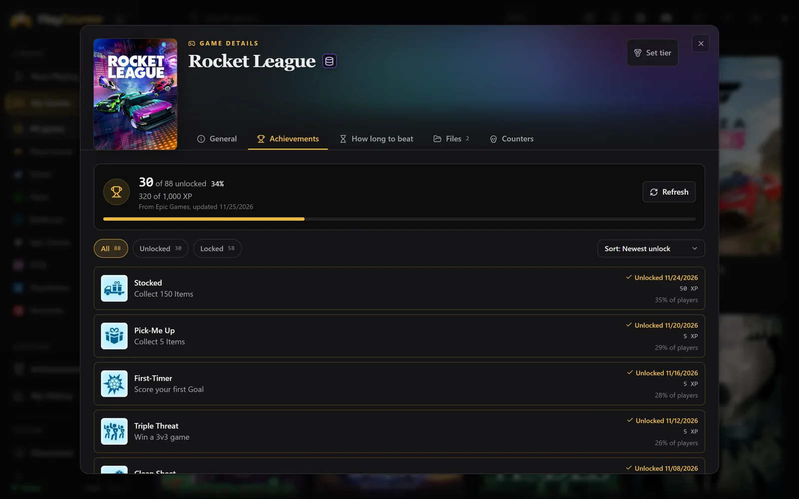
      <br />
      <b>Achievements.</b> What you unlocked on Steam, Xbox, Epic Games and GOG,
      and your PlayStation trophies. PlayCounter adds its own milestones for the
      hours you put in.
    </td>
  </tr>
</table>

### From the couch

Use PlayCounter with an Xbox or PlayStation controller: move through your
library, start and stop games, open details and switch tabs. F11 puts it in
fullscreen for the TV.

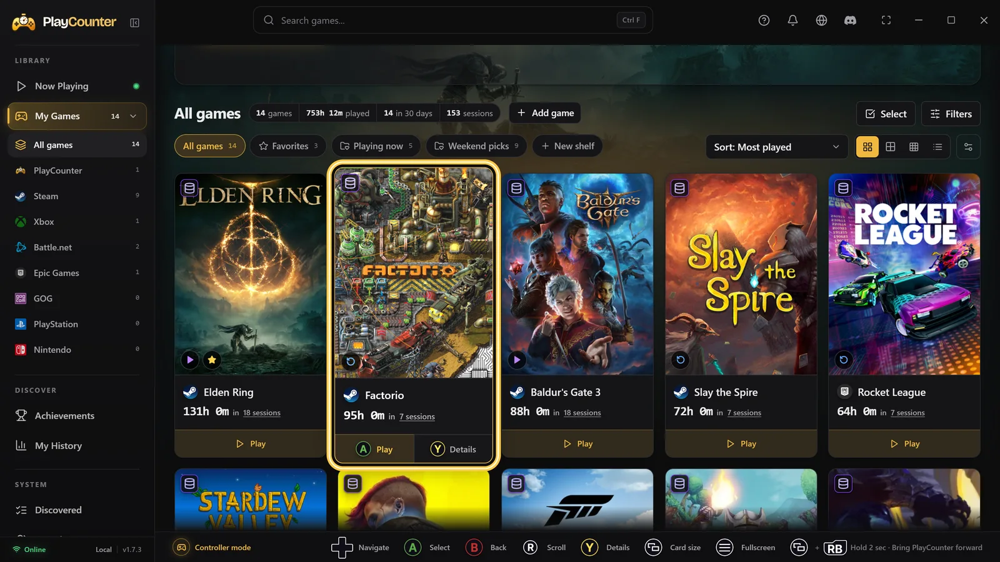

### Emulators and PC ports

The game, not just the emulator: with these fourteen emulators, each game gets
its own cover, total and sessions.

| Emulator    | Systems                   | Emulator | Systems         |
| ----------- | ------------------------- | -------- | --------------- |
| DOSBox      | DOS                       | PPSSPP   | PSP             |
| Dolphin     | GameCube, Wii             | Cemu     | Wii U           |
| PCSX2       | PlayStation 2             | Ryujinx  | Nintendo Switch |
| DuckStation | PlayStation               | Eden     | Nintendo Switch |
| RPCS3       | PlayStation 3             | Azahar   | Nintendo 3DS    |
| mGBA        | Game Boy, Color, Advance  | melonDS  | Nintendo DS     |
| Xenia       | Xbox 360                  | BlueStacks | Android       |

PC ports and recompiled games run as normal Windows programs, so they are
tracked like any other game. Ship of Harkinian, 2 Ship 2 Harkinian and Zelda 64:
Recompiled are recognized; a port PlayCounter doesn't know yet can be matched
once in Discovered.

### Everything else

<details>
<summary><b>The full feature list</b></summary>

- Detects recognized games by watching running processes, with no per-launcher
  setup and no requirement to launch through PlayCounter
- Add local entries for games or other processes you choose to track
- Automatic executable-to-game matching against the API
- Steam, Xbox, Epic Games, GOG, PlayStation and Nintendo imports for available
  previous playtime, with game matching and review before import; several
  accounts of one launcher add up, and overlapping provider totals are not
  added together. Battle.net import brings in the game list (Battle.net shares
  no playtime)
- Live PS5 and PS4 sessions through the optional PlayStation sign-in
- Nintendo Switch playtime through the optional Nintendo Account sign-in, read
  again about once an hour
- PC ports and recompiled games are tracked like any other game: Ship of
  Harkinian, 2 Ship 2 Harkinian and Zelda 64: Recompiled are recognized, and a
  port PlayCounter doesn't know yet can be matched once in Discovered
- Watched folders that add games from your game folders and new launcher
  installs
- Dedicated per-game emulator detection for DOSBox, Dolphin, PCSX2, mGBA, Cemu,
  RPCS3, PPSSPP, DuckStation, Ryujinx, Eden, Azahar, melonDS, Xenia and
  BlueStacks, with local review for uncertain matches
- Searchable game library with launcher tabs, grid, list and covers-only
  layouts, shelves (also shelves that hide their games), statuses, S to F tiers
  and custom covers and banners
- Screenshots with a hotkey, with an optional caption, shown on the session
  they were taken in and in game details. With HDR on, the HDR picture is
  converted so bright highlights are kept instead of cut off
- Counters per game (deaths, bosses or anything else), counted with a hotkey,
  a controller or in the app
- Pause and resume a running session, or let it pause by itself when you step
  away, and a live timer on your game
- Controller navigation and a fullscreen mode for the TV
- Session history and statistics for any dates, with editing, splitting and
  combining of sessions, manual entries and playtime adjustments
- A manual timer for play away from this PC, like a console: start it on a
  game, stop it, and it is saved as a session
- Optional software tracking: how long apps like Discord or Spotify run, on
  their own Software page, apart from games
- Achievements for lifetime hours, monthly goals and per-game milestones, plus
  each game's Steam, Xbox, Epic Games and GOG achievements and PlayStation
  trophies
- How long to beat for each game, with your progress
- Journal with notes and playthroughs for every game, plus a note for every
  session (also from a hotkey while you play)
- Help & guides with step-by-step guides that use sample games
- Available in English, German, French, Polish, Russian, Portuguese (Brazil),
  Spanish and Chinese
- Optional Play, Stop and Force stop for your games right from the library,
  desktop popups, a break reminder and configurable shortcuts
- Local backup export and import, plus daily or weekly automatic snapshots in
  app data or a chosen folder (while PlayCounter runs, with catch-up on next
  launch and configurable retention)
- Current / "now playing" view with a system-tray indicator
- Community suggestions and one-time local choices for unknown or ambiguous exes
- Configurable polling and unmatched-retry intervals plus an executable blacklist
- Built-in auto-updater

</details>

<sub>Screenshots show the 1.7.3 interface with example data. Game artwork and
trademarks belong to their owners.</sub>

## Download

**[Download the latest release for Windows →](https://github.com/zntr1/PlayCounter/releases/latest)**

The official release page includes release notes, checksums and available
security-scan results for checking your download. The public installer is for
Windows; macOS and Linux are planned. PlayCounter is also coming to Steam.

## Privacy

- Play tracking happens **locally** on your machine - your history stays there.
- Presence reporting automatically sends your pseudonymous installation ID on
  startup and hourly while running, including in the tray. These reports contain
  no game names or history. The server keeps first/latest report timestamps;
  inactive records are removed after 30 days during hourly cleanup. This is used to determine, whether
  stronger hardware capacity for the PlayCounter online services are needed.
- Automatic game matching sends the required process identifier to the API. On
  Windows this is the executable filename, never its full path.
- Feedback and community game submissions are only sent when you choose those
  actions. No PlayCounter account is required.
- The on-demand Steam importer reads local Steam files and sends only AppIDs
  from the selected local account for metadata resolution; account names,
  playtime, and install paths are not uploaded.
- The optional Xbox importer uses Microsoft sign-in in your browser. The API
  temporarily handles authorization and Xbox game data for that import; the app
  does not see your Microsoft password. So the next import needs no new
  sign-in, the app keeps Microsoft's refresh token on your PC, encrypted with
  Windows data protection.
- The optional Epic Games, GOG, Battle.net, PlayStation and Nintendo importers
  open the service's own sign-in page; PlayCounter does not see your password.
  Playtime, achievements and trophies are read from the service on your PC and
  stay there. Only game identifiers and, for games the API doesn't recognise,
  game titles are sent to the API to resolve names and cover art (for Nintendo
  games, only titles). Sign-ins kept for
  the next import stay on your PC, encrypted with Windows data protection;
  **Sign out** under **Launcher accounts** deletes them.
- With **Live from PlayStation** on, the app asks Sony about once a minute which
  game your console is running; those sessions stay on your PC.
- Emulator detection reads local emulator process information and window
  titles; for BlueStacks it reads BlueStacks' own log to see which app is in
  front. Online matching can send extracted game identifiers (like a disc
  serial, title ID or Android package), filenames or titles; full command lines
  are not uploaded in those automatic matching requests.
- Screenshots are saved as files in your Pictures folder and are never
  uploaded.
- A blacklist lets you exclude any executable from tracking.

See the [privacy policy](https://playcounter.app/datenschutz#en) for data flows
and retention details.

## Why the desktop client is open source

PlayCounter watches your running processes to know when a game starts and stops.
That only works if you trust it. The complete desktop client is open so you can
inspect the process scanner, local storage, and every network request the app
makes. Public contracts document the data exchanged with the matching service.

The production API, database migrations, ingestion pipeline, and operational
deployment code are maintained privately. This does not change the MIT rights
for backend versions that were already published. The exact historical boundary
and the current public/private split are documented in [BACKEND.md](./BACKEND.md).

## Help translate

PlayCounter is available in English, German, French, Polish, Russian,
Portuguese (Brazil), Spanish and Chinese. Spot a wrong or clumsy translation?
Fix it on **[Weblate](https://hosted.weblate.org/projects/playcounter/)**: no coding
needed. Read the short guide on the project page first; it explains the
glossary and the placeholders like `{{game}}`.

## Development

This is a pnpm + Turborepo monorepo:

| Path              | Description                                                        |
| ----------------- | ------------------------------------------------------------------ |
| `apps/desktop`    | Tauri 2 + React 19 + TypeScript desktop app (Rust process scanner) |
| `packages/shared` | Public TypeScript API and local model contracts                    |
| `landing`         | Marketing landing page                                             |

Requires [Node.js](https://nodejs.org/), [pnpm](https://pnpm.io/) (via Corepack),
and the [Rust toolchain](https://www.rust-lang.org/tools/install) plus the
[Tauri prerequisites](https://v2.tauri.app/start/prerequisites/) for your OS.

```bash
corepack enable
pnpm install
```

Run the desktop app in dev mode:

```bash
pnpm desktop:dev
```

Build the desktop app:

```bash
pnpm desktop:build
```

The production client uses the matching service at `api.playcounter.app`.
Desktop tests mock that boundary and do not require access to the private
backend repository.

## License

[MIT](./LICENSE) © zntr1. The license covers the files in the current public
repository. Previously published backend copies retain the MIT rights documented
in [BACKEND.md](./BACKEND.md).
