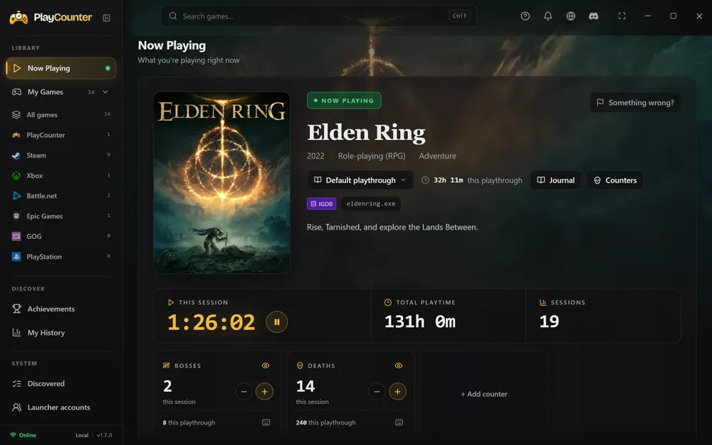
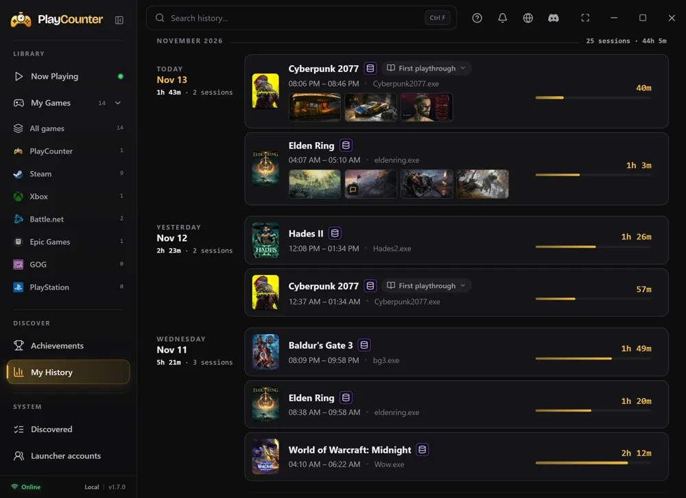
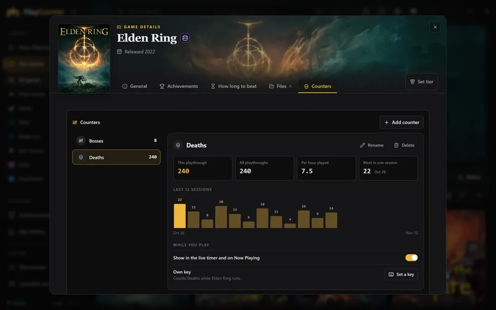
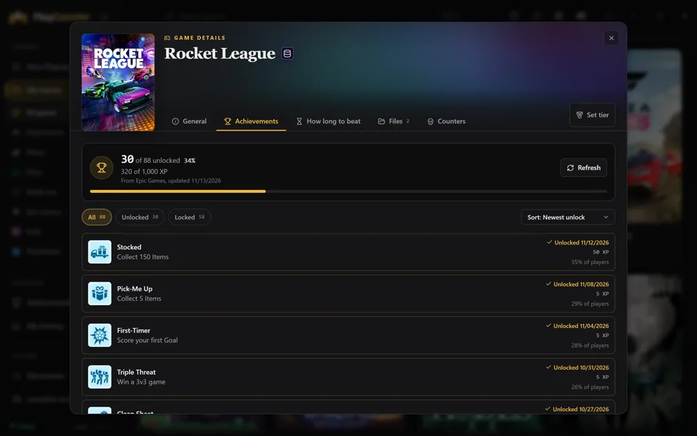
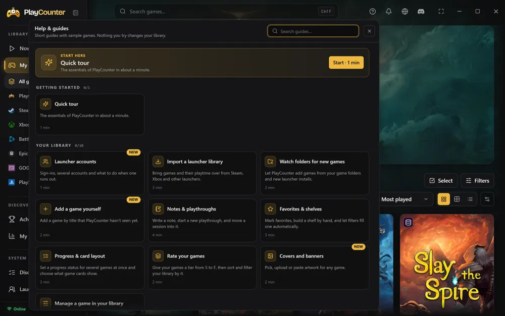

# PlayCounter

**Automatic playtime tracking for Windows, regardless of launcher.**

[](https://github.com/zntr1/PlayCounter/releases/latest)
[](./LICENSE)
[](https://discord.gg/t2nG3jaEEY)
[](https://hosted.weblate.org/projects/playcounter/)

PlayCounter watches what's actually running on your PC and records playtime for
recognized games, regardless of how they were launched (Steam, Epic, GOG, EA,
Ubisoft, Battle.net, an emulator, a shortcut, or a plain `.exe`). Unknown games can be added
locally or submitted as community matches for review. Sessions and recent
history stay on the PC, and the free, open-source app does not require an
account.

Different AI models supported me in developing this application.

## Download

**[Download the latest release for Windows →](https://github.com/zntr1/PlayCounter/releases/latest)**

The official release page includes release notes, checksums and available
security-scan results for checking your download. The public installer is for
Windows; macOS and Linux are planned.

## Screenshots

Screenshots show the 1.7.0 interface with example data.



|                                                       My History                                                       |                                                      Counters                                                       |
| :--------------------------------------------------------------------------------------------------------------------: | :-----------------------------------------------------------------------------------------------------------------: |
|  |  |
|                                                  **Game achievements**                                                 |                                                  **Help & guides**                                                  |
|  |  |

## Help translate

PlayCounter is available in English, German, French, Polish, Russian,
Portuguese (Brazil), Spanish and Chinese. Spot a wrong or clumsy translation?
Fix it on **[Weblate](https://hosted.weblate.org/projects/playcounter/)**: no coding
needed. Read the short guide on the project page first; it explains the
glossary and the placeholders like `{{game}}`.

## Why the desktop client is open source

PlayCounter watches your running processes to know when a game starts and stops.
That only works if you trust it. The complete desktop client is open so you can
inspect the process scanner, local storage, and every network request the app
makes. Public contracts document the data exchanged with the matching service.

The production API, database migrations, ingestion pipeline, and operational
deployment code are maintained privately. This does not change the MIT rights
for backend versions that were already published. The exact historical boundary
and the current public/private split are documented in [BACKEND.md](./BACKEND.md).

## Privacy

- Play tracking happens **locally** on your machine - your history stays there.
- Presence reporting automatically sends your pseudonymous installation ID on
  startup and hourly while running, including in the tray. These reports contain
  no game names or history. The server keeps first/latest report timestamps;
  inactive records are removed after 30 days during hourly cleanup. This is used to determine, whether
  stronger hardware capacity for the PlayCounter online services are needed.
- Automatic game matching sends the required process identifier to the API. On
  Windows this is the executable filename, never its full path.
- Feedback and community game submissions are only sent when you choose those
  actions. No PlayCounter account is required.
- The on-demand Steam importer reads local Steam files and sends only AppIDs
  from the selected local account for metadata resolution; account names,
  playtime, and install paths are not uploaded.
- The optional Xbox importer uses Microsoft sign-in in your browser. The API
  temporarily handles authorization and Xbox game data for that import; the app
  does not see your Microsoft password. So the next import needs no new
  sign-in, the app keeps Microsoft's refresh token on your PC, encrypted with
  Windows data protection.
- The optional Epic Games, GOG, Battle.net and PlayStation importers open the
  service's own sign-in page; PlayCounter does not see your password. Playtime,
  achievements and trophies are read from the service on your PC and stay
  there. Only game identifiers and, for games the API doesn't recognise, game
  titles are sent to the API to resolve names and cover art. Sign-ins kept for
  the next import stay on your PC, encrypted with Windows data protection;
  **Sign out** under **Launcher accounts** deletes them.
- With **Live from PlayStation** on, the app asks Sony about once a minute which
  game your console is running; those sessions stay on your PC.
- Emulator detection reads local emulator process information and window
  titles; for BlueStacks it reads BlueStacks' own log to see which app is in
  front. Online matching can send extracted game identifiers (like a disc
  serial, title ID or Android package), filenames or titles; full command lines
  are not uploaded in those automatic matching requests.
- Screenshots are saved as files in your Pictures folder and are never
  uploaded.
- A blacklist lets you exclude any executable from tracking.

See the [privacy policy](https://playcounter.app/datenschutz#en) for data flows
and retention details.

## Features

- Detects recognized games by watching running processes, with no per-launcher
  setup and no requirement to launch through PlayCounter
- Add local entries for games or other processes you choose to track
- Automatic executable-to-game matching against the API
- Steam, Xbox, Epic Games, GOG and PlayStation imports for available previous
  playtime, with game matching and review before import; several accounts of
  one launcher add up, and overlapping provider totals are not added together.
  Battle.net import brings in the game list (Battle.net shares no playtime)
- Live PS5 and PS4 sessions through the optional PlayStation sign-in
- Watched folders that add games from your game folders and new launcher
  installs
- Dedicated per-game emulator detection for DOSBox, Dolphin, PCSX2, mGBA, Cemu,
  RPCS3, PPSSPP, DuckStation, Ryujinx, Eden, Azahar, melonDS, Xenia and
  BlueStacks, with local review for uncertain matches
- Searchable game library with launcher tabs, grid/list layouts, shelves
  (also shelves that hide their games), statuses, S to F tiers and custom
  covers and banners
- Screenshots with a hotkey, with an optional caption, shown on the session
  they were taken in
- Counters per game (deaths, bosses or anything else), counted with a hotkey,
  a controller or in the app
- Pause and resume a running session, and a live timer on your game
- Session history and statistics for any dates, with editing, splitting and
  combining of sessions, manual entries and playtime adjustments
- Achievements for lifetime hours, monthly goals and per-game milestones, plus
  each game's Steam, Xbox, Epic Games and GOG achievements and PlayStation
  trophies
- How long to beat for each game, with your progress
- Journal with notes and playthroughs for every game, plus a note for every
  session (also from a hotkey while you play)
- Help & guides with step-by-step guides that use sample games
- Available in English, German, French, Polish, Russian, Portuguese (Brazil),
  Spanish and Chinese
- Optional game-launch actions, desktop overlays and configurable shortcuts
- Local backup export and import, plus daily or weekly automatic snapshots in app data or a chosen folder (while PlayCounter runs, with catch-up on next launch and configurable retention)
- Current / "now playing" view with a system-tray indicator
- Community suggestions and one-time local choices for unknown or ambiguous exes
- Configurable polling and unmatched-retry intervals plus an executable blacklist
- Built-in auto-updater

## Project structure

This is a pnpm + Turborepo monorepo:

| Path              | Description                                                        |
| ----------------- | ------------------------------------------------------------------ |
| `apps/desktop`    | Tauri 2 + React 19 + TypeScript desktop app (Rust process scanner) |
| `packages/shared` | Public TypeScript API and local model contracts                    |
| `landing`         | Marketing landing page                                             |

## Getting started

Requires [Node.js](https://nodejs.org/), [pnpm](https://pnpm.io/) (via Corepack),
and the [Rust toolchain](https://www.rust-lang.org/tools/install) plus the
[Tauri prerequisites](https://v2.tauri.app/start/prerequisites/) for your OS.

```bash
corepack enable
pnpm install
```

Run the desktop app in dev mode:

```bash
pnpm desktop:dev
```

Build the desktop app:

```bash
pnpm desktop:build
```

The production client uses the matching service at `api.playcounter.app`.
Desktop tests mock that boundary and do not require access to the private
backend repository.

## License

[MIT](./LICENSE) © zntr1. The license covers the files in the current public
repository. Previously published backend copies retain the MIT rights documented
in [BACKEND.md](./BACKEND.md).
